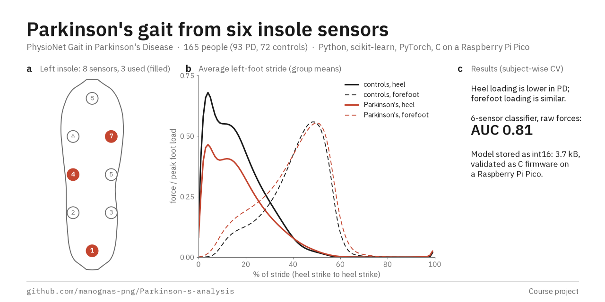

# Parkinson's gait from insole sensors



Course project on the PhysioNet **Gait in Parkinson's Disease** dataset. It covers signal
processing and linear algebra (SVD, sensor networks, DMD), subject-wise machine learning, and
finding a small sensor set. It ends with a six-sensor classifier stored in 3.7 kB that runs as
C firmware on a Raspberry Pi Pico.

**Research project only. This is not a diagnostic tool.**

## Results

All AUCs are subject-wise cross-validated: 5 folds × 10 repeats, and a person's data is never
in both the training and the test set. Each value is the mean over the 10 repeats. Brackets
give a 95% bootstrap interval over subjects (2,000 resamples).

| Model | AUC | Needs |
|---|---|---|
| Measured walking speed alone (logistic) | 0.771 [0.70–0.84] | stopwatch |
| Gait features, all 16 sensors (SVD, network, DMD, swing CV) | 0.729 [0.66–0.82] | full insole |
| Same features, 6 sensors (heel, midfoot, forefoot per foot) | 0.753 [0.70–0.85] | 6 sensors |
| Autoencoder deviation score | 0.688 [0.62–0.78] | 6 sensors + body weight |
| **Insole-only classifier, no body weight** | **0.812** | **6 sensors** |
| Insole-only classifier, forces ÷ body weight | 0.823 [0.78–0.90] | 6 sensors + body weight |
| Stance centre-of-pressure features (AP-COP10, after Sifat et al. 2026) | 0.869 [0.83–0.93]* | 16 sensors |

\* The interval is from the pooled bootstrap; the pooled AUC itself is 0.884.

- **Speed from the insole:** ridge regression on single strides estimates walking speed with
  R² 0.67 (mean absolute error 0.098 m/s).
- **Sensor subset:** the 6-sensor set keeps the 16-sensor AUC. Ratio 1.05 [0.95–1.15]; the
  criterion stated before the run was at least 90% of the 16-sensor AUC, and better than the
  median of 100 random 6-sensor sets.
- **Storage:** storing the model as int16 integers changes the AUC by less than 0.001
  (0.8231 → 0.8232).
- **Microcontroller:** the C version computes its features in exactly the device's steps (CV AUC
  0.814). On all 165 recordings it matches the Python reference to about 1e-6 in single precision.
- **Hardest study:** leave-one-study-out testing shows the treadmill study (Si) is consistently
  the hardest to classify.

The full method, maths and code walk-through is in [docs/project_explainer.pdf](docs/project_explainer.pdf).

## Data

- **Source:** [PhysioNet Gait in Parkinson's Disease](https://physionet.org/content/gaitpd/1.0.0/)
  (Open Data Commons Attribution License v1.0).
- **Subjects:** 165 total (93 with PD, 72 controls) from three studies:

  | Study | Protocol | PD | Control |
  |---|---|---|---|
  | Ga (Yogev et al. 2005) | overground walking (+ dual task) | 29 | 18 |
  | Ju (Hausdorff et al. 2007) | overground walking | 29 | 25 |
  | Si (Frenkel-Toledo et al. 2005) | treadmill walking | 35 | 29 |

- **Signals:** vertical force in newtons from 8 sensors under each foot, at 100 Hz. Walk `_01`
  (normal walking) is used for every subject.
- **Not in this repository.** Download it into `data/raw/`:

  ```bash
  wget -r -N -c -np -nH --cut-dirs=3 -P data/raw https://physionet.org/files/gaitpd/1.0.0/
  cd data/raw && sha256sum -c --quiet SHA256SUMS.txt   # no output = all files OK
  ```

**Known quirks in the dataset:**
- Demographics row `Juc010` should be `JuCo10`, which has no trial files.
- Ju heights are in cm; Ga and Si heights are in metres.
- `Speed_10` does not match the `_10` files that exist.

## Setup and reproducing the results

You need Python 3.11.

```bash
python3.11 -m venv .venv
source .venv/bin/activate
pip install -r requirements.txt
```

The analyses were run on a SLURM cluster. One script reruns every step in order, then checks
the headline numbers and compares every result file with the committed version (about 2 hours
on 16 CPUs):

```bash
sbatch --account=<your_account> slurm/full_rerun.sbatch
```

To run a single step without SLURM, use `python -m src.run_insole_regression` (and similarly for
the other steps). The per-step scripts in `slurm/` list their CPU and memory needs.

## Repository layout

```
src/             analysis code: loading, stride detection, features, models, evaluation
  load.py, gait.py, features_math.py, evaluate.py, models.py   shared building blocks
  run_*.py, plot_*.py                                           one script per analysis step
results/         figures/ and metrics/ (CSV) written by the scripts
firmware/        C model, Pico program, Wokwi circuit, export and validation (see firmware/README.md)
demo/            self-contained interactive web demo (demo/gait_demo.html; open in a browser)
docs/            study guide (HTML + PDF) and the preview image
slurm/           job scripts for each step and for the full rerun
```

## Limitations

- **Small sample:** 165 people from three laboratory studies, so the AUC intervals are about ±0.06.
- **Protocol confounding:** the protocol (treadmill vs overground) differs by study, so per-study
  and leave-one-study-out results matter as much as the pooled numbers.
- **Speed:** much of the group difference is slower walking.
- **TUG:** Timed Up-and-Go time is used only as a mobility proxy; no falls were recorded.
- **Descriptive comparisons:** the speed-adjusted group comparisons in Steps 6 and 9 fit the
  adjustment on all controls. They describe the groups and are not cross-validated results.
- **Sensor choice:** the QR-pivoting sensor sets were chosen from all controls. The 6 anatomical
  sensors were picked after comparing the candidates on the same cross-validation, so their
  AUCs may be slightly optimistic.

## References

- Goldberger A, et al. PhysioBank, PhysioToolkit, and PhysioNet. *Circulation* 101(23):e215–e220, 2000.
- Yogev G, et al. Dual tasking, gait rhythmicity, and Parkinson's disease. *Eur J Neurosci* 22:1248–1256, 2005.
- Hausdorff JM, et al. Rhythmic auditory stimulation modulates gait variability in Parkinson's disease. *Eur J Neurosci* 26:2369–2375, 2007.
- Frenkel-Toledo S, et al. Treadmill walking as an external pacemaker to improve gait rhythm and stability in Parkinson's disease. *Mov Disord* 20(9):1109–1114, 2005.
- Sifat et al. 2026, arXiv:2609.22956 (stance-indexed centre-of-pressure features).
